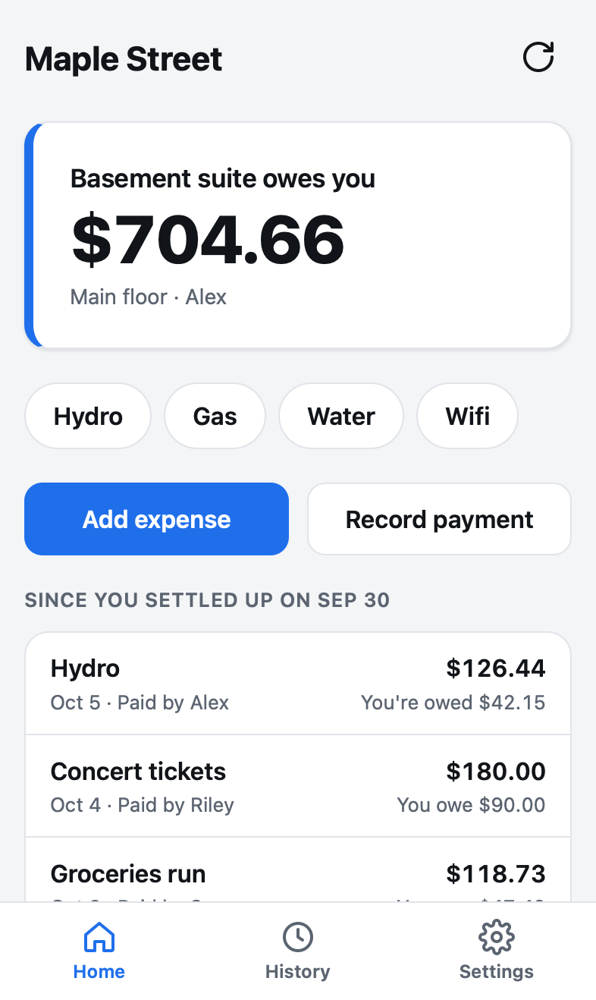
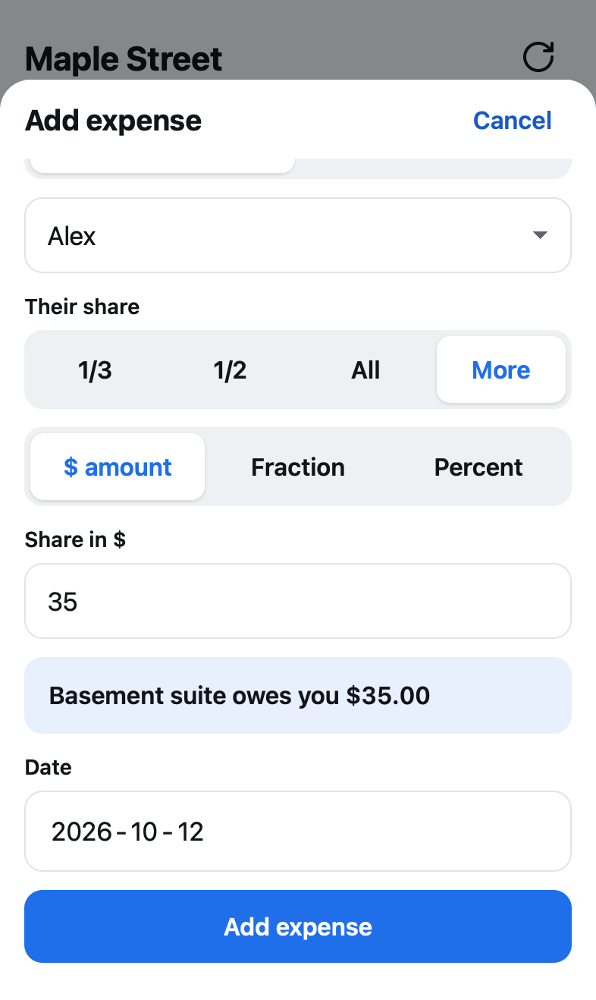
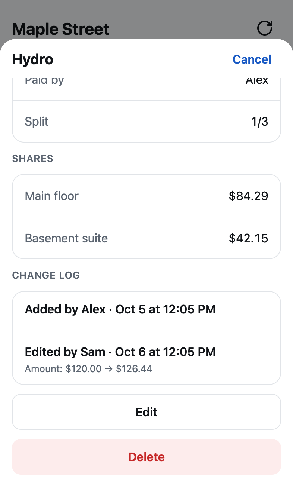
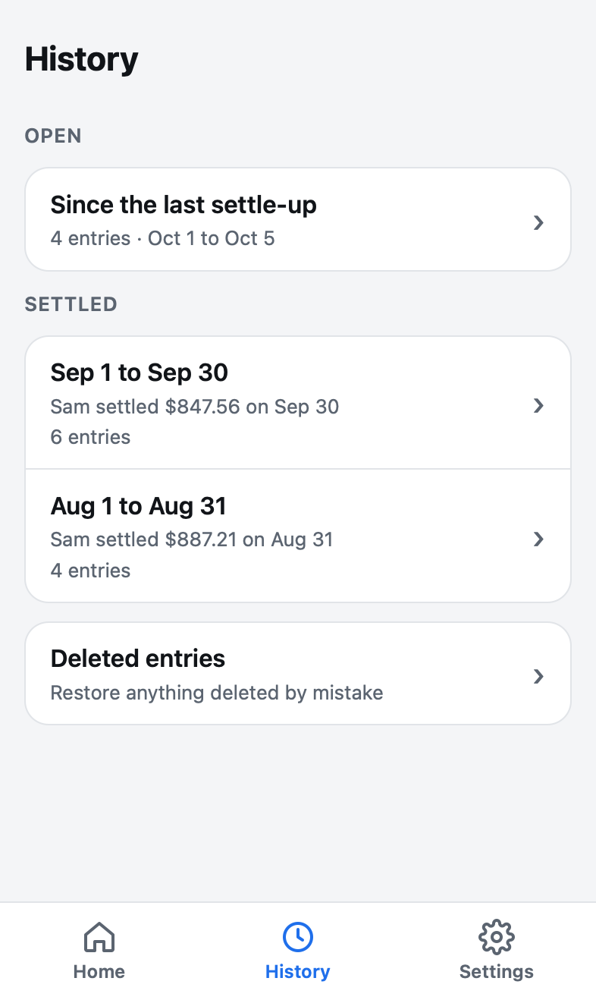
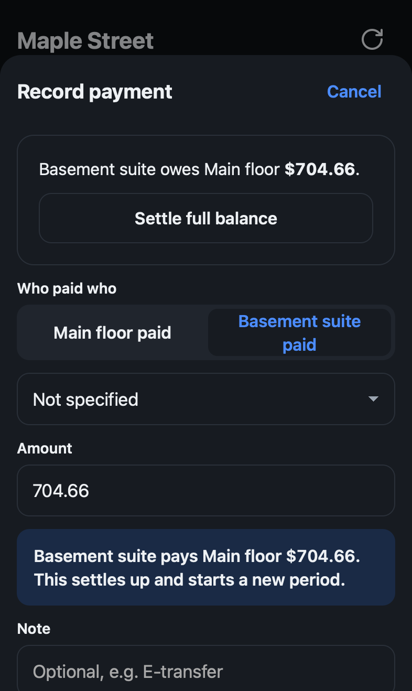
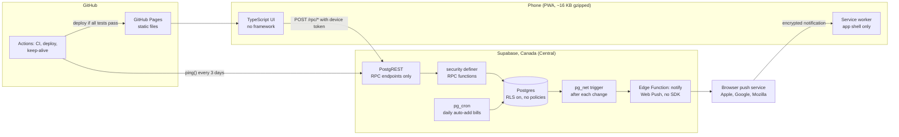

# Evenly

A small mobile web app for tracking shared money between households: monthly bills, outings, one-off expenses and the payments that settle them. It replaced a shared note and a spreadsheet for the two households in one house.

[](https://github.com/pierremakhlouta/evenly/actions/workflows/ci.yml)

**Live:** https://pierremakhlouta.github.io/evenly/ (a group code and PIN are needed to join). Screenshots below use made-up seed data only.

| Home                                                                                   | Add expense                                                          | Entry and change log                                                                | History                                                               | Settle up (dark)                                                    |
| -------------------------------------------------------------------------------------- | -------------------------------------------------------------------- | ----------------------------------------------------------------------------------- | --------------------------------------------------------------------- | ------------------------------------------------------------------- |
|  |  |  |  |  |

## What it does

- **Join once per phone** with a group code and PIN, then pick your name and enter your personal PIN, so nobody can add entries as someone else. The first person in a group is its admin and adds everyone else.
- **Home** shows one balance phrased from your side ("Basement suite owes you $704.66") and everything added since the last settle-up, each entry saying what it did to your balance.
- **Add expense**: who paid, and the other side's share (1/3, 1/2, all, a $ amount, a fraction or a percentage), with a live "Basement suite owes you $35.00" preview.
- **Monthly bills**: saved bills like Hydro are one-tap buttons that pre-fill Add expense; fixed bills like rent are added automatically every month by a scheduled database job.
- **Record payment**: partial payments, or **Settle full balance**, which zeroes the balance and starts a new period.
- **History**: settle-up periods, newest first, each one opening to its entries, plus a Deleted list to restore from.
- **Every entry** opens to its shares and a plain-words change log ("Edited by Sam · Amount: $120.00 → $126.44"), and can be edited, deleted or restored.
- **Settings**: rename the group and households; admins manage people (rename, move, make admin, reset a PIN, remove); see and revoke phones; export every entry as CSV.
- **Notifications**: turn them on per phone in Settings to hear about every new, edited or deleted entry from someone else ("Sam added Hydro · $134.12"). On iPhone this works once Evenly is on the Home Screen.
- **Installable**: add it to the home screen on iPhone or Android. It opens full screen and starts even offline; data is never cached, so balances are always live.
- **Accessible**: every screen passes WCAG 2.2 AA checks (axe-core) in light and dark mode, and wording, never color alone, says who owes who.

## Two modes, one engine

- **Household mode**: people belong to one of two households, and the app shows one balance between them.
- **People mode**: every person is their own side, Splitwise style. Expenses are split between any of them (equally, by amounts, percent or shares), Home shows everyone's balance and the fewest payments that settle the group, and **Settle up everyone** records them all at once.

Money always moves between _parties_. In household mode a party is a household; in people mode it is a person. Household mode is simply the two-party case, so both modes share one database, one set of split math and one debt simplifier (checked to give identical payments in TypeScript and SQL).

## Architecture



## Money rules

- All money is integer cents. No floating point anywhere, including display and parsing of typed amounts.
- Every entry stores one share row per party, and the shares always add up exactly to the total (enforced by a deferred constraint trigger).
- A party's net position is what it paid minus its shares. Nets always sum to zero.
- Household splits round the other household's share half up; the payer gets the remainder.
- People-mode splits (equal, amounts, percent, weights) use largest-remainder allocation with ties broken by sort order.
- Debts between N people settle in at most N - 1 payments: repeatedly match the largest creditor with the largest debtor. The database computes the payments it records; the phone's list is only a preview it must match.

The same cases in [`shared/test-vectors.json`](shared/test-vectors.json) test both the TypeScript code (Vitest) and the SQL functions (pgTAP), so they must agree to the cent. The database is the source of truth: it computes and stores the shares, and the TypeScript copy only powers the live preview in forms.

## Security model

There are no user accounts. Each group has a shared PIN, entered once per phone, and each person has a personal PIN.

```
Phone                              Supabase (Postgres)
-----                              -------------------
register_device(code, PIN)      -> bcrypt check; lockout after 10 failures in 15 min
                                <- random 32-byte token (only its sha256 is stored)
set_device_person(person, PIN)  -> personal PIN (bcrypt), locked out per person
get_summary(token)              -> require_device(token) -> caller's group only
add_entry(token, ...)           -> validate, compute shares, log the change
```

- The browser only has the project URL and the publishable key. Every table has row level security on with **no policies**, and all table privileges are revoked from the API roles, so the key can read nothing directly.
- The only way in is a fixed list of `security definer` RPC functions with an empty `search_path`. A test fails CI if anything else becomes callable.
- Every RPC resolves the caller's group from the device token, and composite `(group_id, id)` foreign keys make cross-group references impossible at the database level.
- Secrets (PIN hashes, device token hashes, PIN attempts) live in a `private` schema the API cannot reach.
- Admin-only actions (managing people, renaming the group) are checked in the database, and a group always keeps at least one admin.
- Deletes are soft, and every create, edit, delete and restore is written to an append-only change log.
- No analytics, trackers or third-party scripts.

## Testing

| Layer              | Tool                 | What it covers                                                                                                                             |
| ------------------ | -------------------- | ------------------------------------------------------------------------------------------------------------------------------------------ |
| Money and UI logic | Vitest (+ happy-dom) | Splits, balances, debt simplification, formatting and parsing, forms, CSV export                                                           |
| Database           | pgTAP                | Lockdown, group isolation, PIN lockouts, every RPC, settle-up periods, auto-added bills, split and balance math against the shared vectors |
| End to end         | Playwright           | The real app against a local Supabase stack on emulated iPhone Safari (WebKit) and Android Chrome                                          |
| Accessibility      | axe-core             | WCAG 2.2 A and AA on every screen and sheet, light and dark                                                                                |
| PWA                | Playwright           | The production build: manifest, icons, opening offline, nothing but the app shell cached                                                   |

## Run it locally

Requires Node 22.12 or newer, Docker and the Supabase CLI.

```sh
npm install
supabase start         # local Postgres and API
supabase db reset      # apply migrations and the fake seed
npm run dev            # http://localhost:5173/evenly/
```

```sh
npm run check          # typecheck, lint, format check, unit tests, build
supabase test db       # pgTAP tests
npm run e2e            # end-to-end, accessibility and PWA tests
npm run screenshots    # retake the README screenshots from the seed
```

The seed's local-only logins are `HHHH-2222` (household mode) and `PPPP-3333` (people mode), both with group PIN and personal PINs `1234`.

## Deploys and operations

- **CI** runs on every push and pull request in three parallel jobs: checks and unit tests; pgTAP against a fresh Postgres; Playwright against a fresh local Supabase stack.
- **Deploy**: when CI passes on `main`, a second workflow builds that exact commit and deploys it to GitHub Pages. A failing check never reaches the live site.
- **Database changes** are forward-only SQL migrations in [`supabase/migrations`](supabase/migrations), applied with `supabase db push`.
- **Notifications** need a one-time setup: `npm run setup:push` (keys into Supabase secrets and a GitHub variable), `supabase functions deploy notify`, and the function URL in Vault.
- **Keep-alive**: the free Supabase plan pauses idle projects, so a scheduled workflow calls the read-nothing `ping()` RPC every 3 days.
- **Backups**: the free plan keeps none, so Settings exports every entry as CSV; export once a month.

See [DECISIONS.md](DECISIONS.md) for every decision and the alternatives considered.
